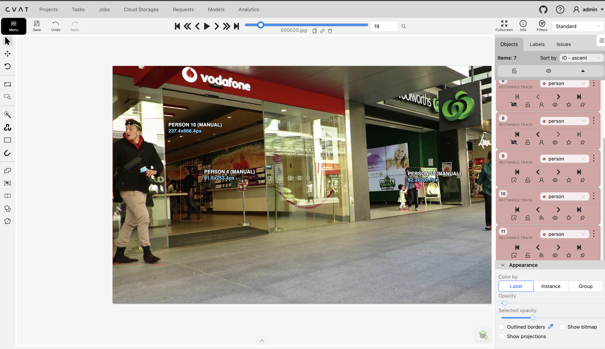
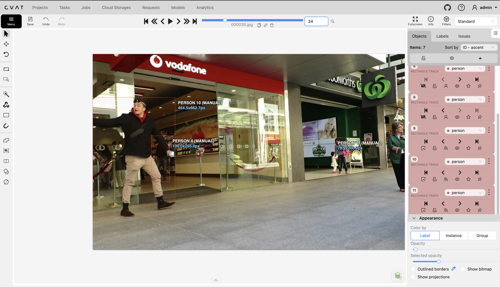

# Báo cáo cá nhân — Phạm Vũ Tùng Dương

Đoạn video: MOT17-09, 150 frame (CVAT frame 0–149), nguồn MOTChallenge, giấy phép CC BY-NC-SA 3.0.

## 0. Thông tin học viên

- Họ tên: Phạm Vũ Tùng Dương
- MSSV: 2A202603319
- Mã đề: C
- Link repository: https://github.com/zenlylove/K5-L2-MOTTracking-PhamVuTungDuong-2A202603319
- Thời gian tự ghi trước đó: 16:00–18:33 (GMT+7). Ảnh trang CVAT cho thấy job được tạo lúc 16:45, cập nhật lúc 18:37 ngày 13/11/2026 và trạng thái `completed`; CVAT hiển thị duration 3 giờ. Các mốc này không hoàn toàn trùng nhau nên cần dùng mốc nào đúng với thời gian thực tế đã làm.
- Bằng chứng trạng thái job: [Completed.png](../../src/exports/Completed.png).

## 1. Xem trước đoạn video (CP0)

Mốc xuất hiện/kết thúc và các đoạn `occluded` được trích từ file CVAT/MOT cuối; nhận xét quỹ đạo dưới đây suy ra từ tọa độ box đã lưu, không phải ghi chép xem trước trước khi vẽ.

| Mã | Frame xuất hiện trong file | Frame cuối có box | Quan sát chuyển động từ video | Các đoạn có cờ `occluded` | Ghi chú |
|---|---:|---:|---|---|---|
| P1 | 0 | 149 | Tâm box dịch sang phải từ x≈297 đến x≈509; chiều cao tăng dần, rồi vị trí gần như ổn định. | 10–56, 97–112 | Cờ được bật ở các đoạn này, không có `outside`. |
| P2 | 61 | 149 | Từ lúc xuất hiện, tâm box dịch sang phải rồi dao động quanh x≈370–393; box lớn dần. | 61–100, 103–110 | Không có box trước frame 61. |
| P3 | 0 | 149 | Tâm box dịch từ sát mép phải về bên trái (x≈1893 xuống ≈1386); kích thước box tăng rõ. | 0–9, 30–67 | Kiểm tra box đầu đoạn và thay đổi kích thước. |
| P4 | 0 | 139 | Tâm box gần như giữ quanh x≈1370 trong phần lớn track, sau đó box nhỏ lại ở cuối đoạn. | 0–109, 123–134, 136–139 | MOT export không có box ở 110–122, 135. |
| P5 | 0 | 149 | Tâm box dịch mạnh sang phải (x≈59 đến ≈1519), đồng thời chiều cao box giảm về cuối đoạn. | 0–36, 110–119, 122–136, 147–149 | MOT export không có box ở 120–121, 137–146. |

## 2. Keyframe và thời gian (CP1, CP4)

Số liệu keyframe lấy từ CVAT for video 1.1. Các mã P được đối chiếu theo đề C (MOT IDs 1, 7, 20, 22, 23). “Số frame có mặt” là số frame có box trong MOT export.

| Mã | Số keyframe | Frame có mặt | Keyframe / 100 frame | Thời gian (phút) | Khung/đoạn cần kiểm tra |
|---|---:|---:|---:|---|---|
| P1 | 39 | 150 | 26.0 | Không ghi theo từng người | Đoạn che 10–56, 97–112 |
| P2 | 23 | 89 | 25.8 | Không ghi theo từng người | Bắt đầu ở 61; box tăng kích thước |
| P3 | 45 | 150 | 30.0 | Không ghi theo từng người | Kiểm tra box thay đổi kích thước ở frame 1 |
| P4 | 22 | 126 | 17.5 | Không ghi theo từng người | Kiểm tra box nhảy ở frame 128 và các đoạn vắng |
| P5 | 60 | 138 | 43.5 | Không ghi theo từng người | Kiểm tra biến động box ở 118–130 và 148–149 |
| **Tổng** | **189** | **653** | **28.9** | **Không có log thời gian chi tiết** | |

Keyframe / 100 frame của cả bài = 189 ÷ 653 × 100 = **28.9**.

Người có nhiều keyframe nhất: **P5 (60)**. Con số này cao hơn bốn track còn lại; cần kiểm tra các đoạn keyframe dày quanh frame 110–136 để chắc rằng các mốc phản ánh thay đổi chuyển động/che khuất, không chỉ chỉnh box liên tục.

## 3. Đoạn bị che (CP2)

Người được chọn theo hướng dẫn CP2: **P1**.

| Mốc | Frame CVAT |
|---|---:|
| Bắt đầu đoạn `occluded` thứ nhất | 10 |
| Kết thúc đoạn `occluded` thứ nhất | 56 (cờ tắt ở 57) |
| Bắt đầu đoạn `occluded` thứ hai | 97 |
| Kết thúc đoạn `occluded` thứ hai | 112 (cờ tắt ở 113) |
| Bật/tắt `outside` | Không có frame `outside` trong track P1 |

- Hai đoạn mang cờ `occluded` dài lần lượt **47** và **16 frame**. Cờ này biểu thị che một phần, không xác nhận có frame nào khuất hoàn toàn.
- Trong annotation hiện tại, P1 giữ cùng một track qua cả hai đoạn; box vẫn có ở mọi frame 0–149. Do không có trạng thái `outside`, không thể tính thời gian khuất hẳn hoặc kết luận quy tắc 60 frame đã được áp dụng cho một lần khuất hoàn toàn.
- Ở frame 9–10, cờ đổi từ tắt sang bật; ở 56–57 và 112–113, cờ đổi chiều. Cần xác nhận trực quan các ranh giới này và box amodal trên CVAT trước khi xem phần che khuất là đạt.

Ảnh hiện có:





Ảnh thứ ba hiện tại là frame 42 theo chỉ số CVAT, nằm trong khoảng `occluded` 10–56; vì vậy bộ ảnh hiện có chưa chứng minh P1 đã hiện lại. Nếu cần đủ bộ minh chứng CP2, chụp frame sau khi cờ tắt ở 57 và lưu thành `che_3_sau.png`.

## 4. Tự review ID (CP3)

Không có nhật ký riêng chứng minh đã thực hiện hai lượt review theo CP3. Bảng dưới đây chỉ ghi các điểm cần kiểm tra được tìm thấy qua rà soát kỹ thuật file xuất và script; đây không phải bằng chứng rằng học viên đã tự review hai lượt.

| Frame | Mã người | Loại lỗi cần kiểm | Mô tả | Nguồn phát hiện | Đã sửa? |
|---:|---|---|---|---|---|
| 1 | P3 | `drift` (nghi ngờ) | Chiều cao box thay đổi hơn 30% trong một frame theo checker; xác nhận box có co giật hay không trên ảnh gốc. | Script tự kiểm | Chưa xác minh |
| 118, 125, 148–149 | P5 | `drift` (nghi ngờ) | Checker báo thay đổi chiều cao box vượt ngưỡng; đối chiếu lại box và cờ che khuất ở các frame này. | Script tự kiểm | Chưa xác minh |
| 128 | P4 | `drift` / `id_switch` (nghi ngờ) | Tâm box nhảy xa trong một frame; xác nhận người được gán trước/sau frame 128 có cùng danh tính. | Script tự kiểm | Chưa xác minh |
| — | — | `false_track` (nghi ngờ) | CVAT XML có hai track (ID 2 và 3) không có frame hiển thị; kiểm tra trong job và xóa nếu là object thừa. | Script tự kiểm | Chưa xác minh |

Tổng hợp số lỗi theo loại sau khi review:

| `id_switch` | `fragmentation` | `lost` | `merge` | `false_track` | `drift` | `flag` |
|---:|---:|---:|---:|---:|---:|---:|
| Chưa xác minh | Chưa xác minh | Chưa xác minh | Chưa xác minh | 2 ứng viên (chưa xác nhận) | 3 nhóm track có cảnh báo | Chưa xác minh |

Không có bằng chứng để xác định lỗi nào chỉ được phát hiện ở lượt 2. Cần hoàn thành hai lượt theo CP3, ghi kết quả và sửa các cảnh báo sau khi xem trực tiếp trên CVAT.

## 5. File xuất và kết quả tự kiểm (CP4)

| Kiểm tra | Kết quả |
|---|---|
| Tên file MOT 1.1 | `src/exports/PhamVuTungDuong_mot.zip` |
| Tên file CVAT for video 1.1 | `src/exports/PhamVuTungDuong_cvat_video.zip` |
| Số track ID trong MOT `gt/gt.txt` | 5 |
| Frame `outside` không có dòng trong `gt.txt` | Có. Đã đối chiếu tập frame có box của cả 5 track: khớp với frame `outside=0` trong CVAT XML. |
| Job đã completed trên CVAT máy cá nhân | Có. Ảnh `src/exports/Completed.png` hiển thị state `completed`, frame range 0–149. |

Kết quả chạy:

```text
Số frame in theo CVAT (bắt đầu từ 0). Trong gt.txt, frame_id = frame CVAT + 1.

=== File MOT 1.1: PhamVuTungDuong_mot.zip ===
  Số track ID: 5   |   Tổng số box: 653
  [OK]        Đúng 5 track ID.

  Track | Frame có mặt | Số frame | Đoạn vắng (outside)
      1 |   0–149      |      150 | -
      2 |   0–149      |      150 | -
      3 |   0–149      |      138 | 120–121, 137–146
      4 |   0–139      |      126 | 110–122, 135
      5 |  61–149      |       89 | -

  [CẢNH BÁO]  Track 2: chiều cao box đổi > 30% trong 1 frame ở frame [1].
  [CẢNH BÁO]  Track 3: chiều cao box đổi > 30% trong 1 frame ở frame [118, 125, 148, 149].
  [CẢNH BÁO]  Track 4: box nhảy xa trong 1 frame ở frame [128].
  [CẢNH BÁO]  Track 4: chiều cao box đổi > 30% trong 1 frame ở frame [124, 126, 127, 129, 130].

=== File CVAT for video 1.1: PhamVuTungDuong_cvat_video.zip ===
  Số track trong annotations.xml: 7 (2 track không có frame hiển thị)
  Keyframe / frame có mặt theo 5 track có box: 189 / 653 = 28.9 keyframe / 100 frame.

  [CẢNH BÁO]  Track 2 chỉ thấy 0 frame: có thể là shape rời hoặc track thừa.
  [CẢNH BÁO]  Track 3 chỉ thấy 0 frame: có thể là shape rời hoặc track thừa.

=== Tóm tắt ===
  Lỗi: 0   |   Cảnh báo: 6
  Không có lỗi định dạng. Cần mở CVAT xem lại từng cảnh báo.
```

**Lưu ý:** đoạn trên rút gọn danh sách frame keyframe của đầu ra script, giữ nguyên số liệu tổng hợp và cả 6 cảnh báo. Bốn cảnh báo box và hai track CVAT không có frame hiển thị vẫn cần được mở lại trên CVAT; sửa/xóa nếu cần, rồi xuất lại cả hai file và chạy lại script. File MOT có đúng 5 ID, danh sách frame có box khớp với CVAT và script không báo lỗi định dạng; các điều này không xác nhận độ chính xác của từng box.

## 6. Ba câu kết

Các câu trả lời dưới đây là kết luận hồi cứu từ file xuất, không khẳng định đã thực hiện các thao tác review chưa có ghi chép.

1. Nếu được gán lại, bạn sẽ đặt keyframe khác ở đâu? Vì sao?

   Nên kiểm tra dày hơn quanh P4 frame 128 và P5 các frame 118–130. Đây là vùng checker báo box nhảy hoặc thay đổi kích thước đột ngột; cần xem từng frame và đặt keyframe tại đúng điểm đổi chuyển động, thay vì thêm keyframe hàng loạt.

2. Có chỗ nào bạn không chắc “cùng ID hay ID mới”? Bạn đã quyết định và ghi chú thế nào?

   File hiện tại giữ một ID cho P1 xuyên suốt hai đoạn `occluded` và không bật `outside`. Vì không có đoạn khuất hoàn toàn được đánh dấu trong export, chưa có đủ dữ liệu để kết luận một tình huống “cùng ID hay ID mới” theo ngưỡng 60 frame.

3. Một lỗi ID trong job của bạn (nếu không còn sót, chọn lỗi đã sửa) có thể làm xe tự lái dự đoán sai chuyển động của người đó như thế nào? Lỗi đó ảnh hưởng MOTA hay IDF1 nhiều hơn?

   Nếu một người bị gán nhầm sang ID của người khác, tracker có thể nối hai quỹ đạo không liên quan và dự đoán sai vị trí/hướng đi tiếp theo. Lỗi đổi ID tác động trực tiếp hơn đến IDF1 vì phép đo này đánh giá tính nhất quán danh tính trên cả quỹ đạo; MOTA cũng bị giảm qua thành phần IDSW. Checker không xác nhận có ID switch trong file này, nên đây là phân tích tình huống, không phải lỗi đã tìm thấy.

## Bonus

### B1 — Hai người đi sát

**Chưa thực hiện/không có bằng chứng trong file nộp.** MOT export hiện có đúng 5 ID mục tiêu; không có hai track bonus bổ sung. Vì vậy không thể báo IDSW cho hai track thêm hoặc yêu cầu điểm B1.

### B2 — So cách đặt keyframe (mô phỏng hồi cứu)

Mô phỏng số học trên CVAT XML: so box đã lưu với box nội suy tuyến tính từ mốc đầu/cuối và các mốc cách nhau 30 frame trong từng đoạn có box liên tục. Số keyframe theo phương án đều gồm mốc đầu/cuối của từng đoạn. Sai khác được tính bằng IoU giữa box mô phỏng và box trong annotation hiện tại; annotation hiện tại không phải ground truth độc lập.

| Track | Keyframe hiện tại | Mốc đều mỗi 30 frame | Frame sai khác lớn nhất | IoU nhỏ nhất tại frame đó |
|---|---:|---:|---:|---:|
| P1 | 39 | 6 | 67 | 0.697 |
| P2 | 23 | 4 | 111 | 0.787 |
| P3 | 45 | 6 | 1 | 0.747 |
| P4 | 22 | 9 | 130 | 0.000 |
| P5 | 60 | 9 | 124 | 0.004 |
| **Tổng** | **189** | **34** | — | — |

Theo mô phỏng, đặt mốc đều giảm số keyframe đáng kể nhưng sai khác lớn ở một số frame, rõ nhất là P4 frame 130 và P5 frame 124. Điều này phù hợp với giới hạn của nội suy tuyến tính khi quỹ đạo/box đổi nhanh, nhưng chưa chứng minh box nào đúng hơn so với người thật. **Chưa đủ điều kiện tính bonus B2:** không có ảnh CVAT minh họa frame trôi nhất và đây là mô phỏng từ export, không phải hai lượt gán độc lập.

### B3 — So với tracker có sẵn

**Chưa thực hiện/không có dữ liệu.** Repo không có output tracker do coach cung cấp; không tự chạy tracker để thay thế phần bonus theo quy định. Do đó chưa thể nêu hai frame khác nhau một cách có căn cứ.

## 7. Tài liệu tham khảo và công cụ AI đã dùng

- Milan et al. (2016), MOTChallenge / MOT17; dataset license CC BY-NC-SA 3.0.
- [MOT 1.1 format và MOTA/IDF1](../../docs/MOT_FORMAT.md).
- CVAT for video 1.1 và MOT 1.1 exports từ job CVAT local.
- Copilot hỗ trợ kiểm tra thống kê, đối chiếu tập frame giữa hai file xuất, rà các cảnh báo và chạy mô phỏng hồi cứu B2. Phần review hai lượt của học viên và kết quả B1/B3 không được ghi giả thành đã thực hiện.
